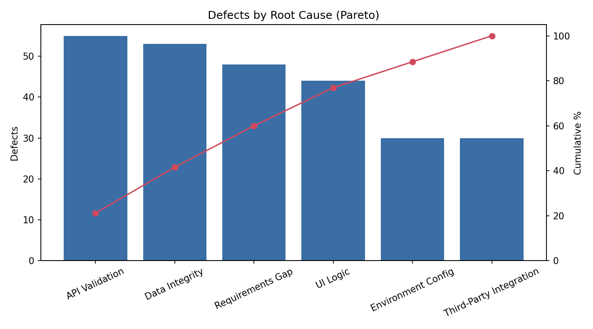
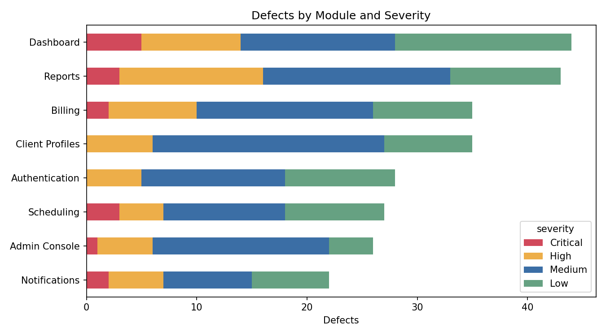

# Defect Analytics Pipeline

A Python pipeline that takes a raw defect tracker export, cleans it, and turns it into a release-readiness report: what's still open, what's critical, where defects come from, and how fast they get fixed.

I built this because tracking defects by hand in spreadsheets gets messy fast. Exports come with duplicate rows, inconsistent casing, and tickets marked "Closed" with no close date. This pipeline handles that cleanup automatically and produces the same summary every time, so the numbers in a release review are consistent and easy to trust.

> All data in this repo is synthetic and generated by `scripts/generate_sample_data.py`. No real company, product, or client data is used.

## What it does

1. **Cleans the raw export**
   - Maps messy values (`"  dashboard"`, `"HIGH "`, `"in progress"`) to one canonical spelling
   - Removes duplicate tickets from double exports
   - Flags data quality problems, like tickets marked done with no resolution date, instead of silently dropping them
2. **Calculates the metrics that matter for a release decision**
   - Open Critical/High count (potential release blockers)
   - Production escape rate (defects that made it past Dev and Staging)
   - Reopen rate
   - Time to resolve by severity
   - Root cause Pareto and module by severity breakdown
   - Weekly opened vs resolved trend and running backlog
3. **Writes a report** to `outputs/summary_report.md` with auto-generated takeaways, plus charts and a cleaned CSV

## Sample output

From the synthetic dataset (260 defects across 8 modules):

| Metric | Value |
|---|---|
| Total defects | 260 |
| Open Critical + High | 26 |
| Production escape rate | 14.6% |
| Reopen rate | 13.8% |
| Median days to resolve | 9.0 |

Key findings the pipeline surfaced:
- API Validation and Data Integrity issues make up 42% of all defects, so that's where prevention effort pays off most
- Reports and Dashboard carry the most Critical/High defects, making them the top candidates for regression coverage
- 7 Critical defects are still open and should block release until resolved or explicitly accepted




Full report: [outputs/summary_report.md](outputs/summary_report.md)

## How to run

```bash
pip install -r requirements.txt

# 1. Generate the sample defect log (already included in data/raw/)
python scripts/generate_sample_data.py

# 2. Run the pipeline
python src/pipeline.py

# Or point it at your own export
python src/pipeline.py --input path/to/export.csv --output outputs
```

## Project structure

```
defect-analytics-pipeline/
├── data/raw/defect_log.csv        # synthetic raw export (messy on purpose)
├── scripts/generate_sample_data.py
├── src/pipeline.py                # clean -> analyze -> chart -> report
└── outputs/
    ├── summary_report.md
    ├── defect_log_clean.csv
    ├── weekly_trend.csv
    └── charts/
```

## Tools

Python, pandas, matplotlib

## What I'd add next

- Pull directly from a tracker API (Jira or Linear) instead of a CSV export
- Track SLA breaches by severity (for example, Critical open more than 3 days)
- Schedule it to run weekly and post the summary to the team channel
