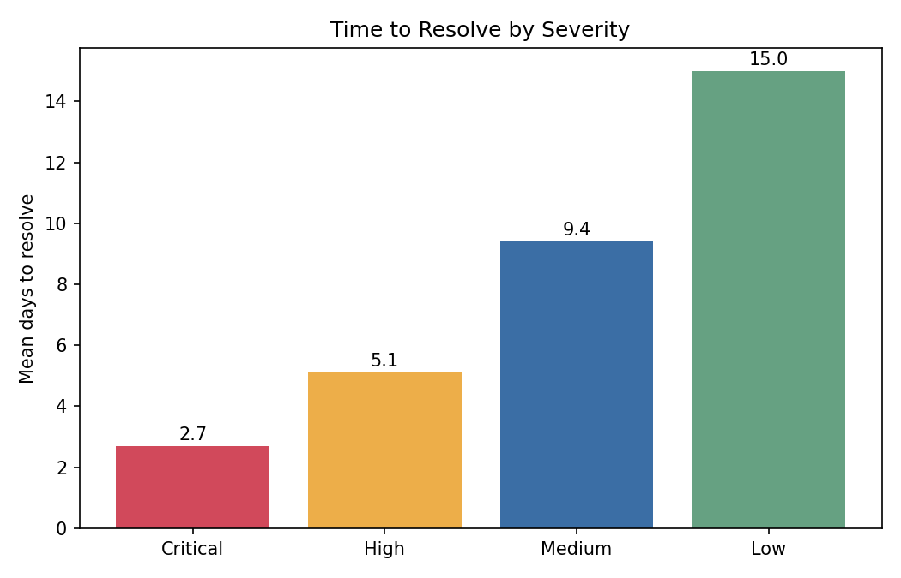
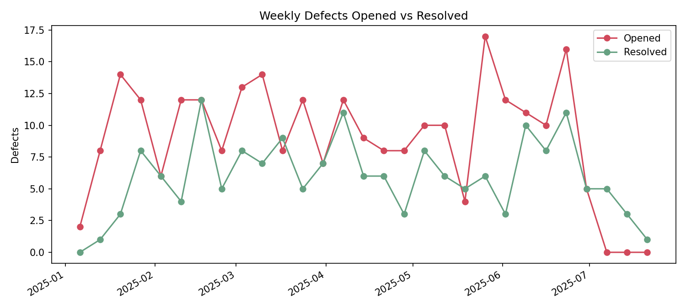

# Defect Analytics Summary

Reporting window: Jan 06, 2025 to Jun 27, 2025. Generated automatically by `src/pipeline.py` from synthetic data.

## Headline metrics

| Metric | Value |
|---|---|
| Total defects | 260 |
| Open (Open / In Progress / Reopened) | 84 |
| Open Critical + High | 26 |
| Found in Production (escape rate) | 14.6% |
| Reopen rate | 13.8% |
| Median days to resolve | 9.0 |

## Key takeaways

- **API Validation** and **Data Integrity** account for 42% of all defects. Putting prevention effort (earlier test cases, clearer specs) into these two areas addresses the biggest share of rework.
- **Reports** has the most Critical/High defects (16), followed by **Dashboard** (14). These are the modules to prioritize for regression coverage.
- 7 Critical defects are still open. These should be release blockers until closed or explicitly accepted.
- 11 Critical/High defects were found in Production, meaning they escaped Dev and Staging testing.
- Critical defects resolve in 2.7 days on average vs 15.0 for Low, so triage by severity is working as intended.

## Data quality notes

- Removed 8 duplicate rows (same defect_id exported twice).
- 4 tickets are Resolved/Closed but have no resolution date (DEF-0070, DEF-0119, DEF-0123, DEF-0204). Excluded from time-to-resolve metrics.

## Status by severity

| severity   |   Open |   In Progress |   Reopened |   Resolved |   Closed |   Total |
|:-----------|-------:|--------------:|-----------:|-----------:|---------:|--------:|
| Critical   |      2 |             4 |          1 |          1 |        8 |      16 |
| High       |     10 |             5 |          4 |          4 |       32 |      55 |
| Medium     |     19 |             8 |         11 |         17 |       61 |     116 |
| Low        |     13 |             7 |          0 |         14 |       39 |      73 |
| Total      |     44 |            24 |         16 |         36 |      140 |     260 |

## Time to resolve by severity (days)

| severity   |   Resolved count |   Mean days |   Median days |   Max days |
|:-----------|-----------------:|------------:|--------------:|-----------:|
| Critical   |                9 |         2.7 |             3 |          4 |
| High       |               35 |         5.1 |             5 |          9 |
| Medium     |               76 |         9.4 |             9 |         16 |
| Low        |               52 |        15   |            15 |         28 |

## Root cause Pareto

| root_cause              |   Defects | Share   | Cumulative share   |
|:------------------------|----------:|:--------|:-------------------|
| API Validation          |        55 | 21.2%   | 21.2%              |
| Data Integrity          |        53 | 20.4%   | 41.5%              |
| Requirements Gap        |        48 | 18.5%   | 60.0%              |
| UI Logic                |        44 | 16.9%   | 76.9%              |
| Environment Config      |        30 | 11.5%   | 88.5%              |
| Third-Party Integration |        30 | 11.5%   | 100.0%             |

## Defects by module and severity

| module          |   Critical |   High |   Medium |   Low |   Total |
|:----------------|-----------:|-------:|---------:|------:|--------:|
| Dashboard       |          5 |      9 |       14 |    16 |      44 |
| Reports         |          3 |     13 |       17 |    10 |      43 |
| Client Profiles |          0 |      6 |       21 |     8 |      35 |
| Billing         |          2 |      8 |       16 |     9 |      35 |
| Authentication  |          0 |      5 |       13 |    10 |      28 |
| Scheduling      |          3 |      4 |       11 |     9 |      27 |
| Admin Console   |          1 |      5 |       16 |     4 |      26 |
| Notifications   |          2 |      5 |        8 |     7 |      22 |

## Charts

